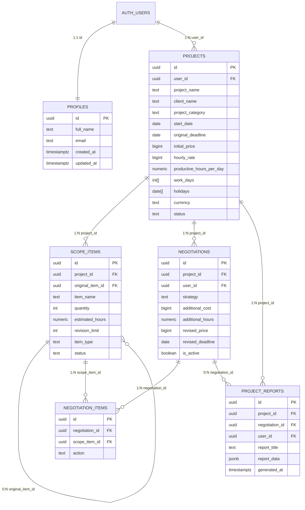

# Arsitektur Backend & Sistem — ScopeLens v2.0

## 1. Ringkasan Arsitektur Final
ScopeLens menggunakan arsitektur **Hybrid Client-Side Engine + PostgreSQL/Supabase Service Layer**:
- **Business Logic Engine (`src/engine/`):** 100% deterministik, berjalan lokal di client-side (TypeScript murni, tanpa ketergantungan jaringan saat demo/interaksi).
- **State Management (`src/stores/useScopeLensStore.ts`):** Zustand mengelola *local draft* selama freelancer mengedit di *Interactive Split-Screen Studio* agar tidak membombardir database setiap ketikan, lalu menyimpan atomik saat tombol **Simpan** ditekan.
- **Service Layer (`src/services/`):** Memisahkan komunikasi Supabase (`authService`, `projectService`, `scopeService`, `negotiationService`, `reportService`) dari UI dan business engine.
- **Database PostgreSQL + RLS (`supabase/migrations/`):** Seluruh tabel dilindungi Row Level Security (`auth.uid()`), constraint relasional ketat, serta PostgreSQL RPC (`SECURITY INVOKER`) untuk transaksi multi-tabel yang atomik.
- **Demo Mode Offline-Safe:** Berjalan penuh dengan `localStorage` fallback tanpa membutuhkan akun atau koneksi backend.

---

## 2. Database ERD (Mermaid)

---

## 3. Alur Authentication & RLS
1. Pengguna mendaftar/masuk via `authService` (`supabase.auth.signUp` / `signInWithPassword`).
2. Trigger `on_auth_user_created` otomatis menyisipkan baris baru ke `public.profiles`.
3. JWT Session disimpan aman oleh Supabase JS Client. Frontend **hanya** memakai `VITE_SUPABASE_ANON_KEY` (publishable key), **tidak pernah** menyimpan `service_role` key.
4. Setiap query `SELECT / INSERT / UPDATE / DELETE` diperiksa langsung oleh PostgreSQL RLS (`(SELECT auth.uid()) = user_id` atau `EXISTS (...)` ke kepemilikan `projects`).

---

## 4. Alur Data Frontend → Engine → Database
1. User membuka Studio (Demo Mode langsung aktif atau memilih proyek Cloud setelah login).
2. Perubahan di *Split-Screen Studio* memperbarui state Zustand secara instan (`updateScopeItemLocal`, `addScopeItem`, `setNegotiationStrategy`, `toggleSwappedOutItem`).
3. Selector `useMemo` menjalankan `simulateNegotiation()` dan `generateNegotiationMessages()` secara sinkron (< 1 ms) sehingga *Sticky Impact Bar*, *Recharts*, maskot *Lensy*, dan pesan WhatsApp/Email terbarui *real-time*.
4. Saat user menekan **Simpan**, `saveProjectWorkspace()` memanggil PostgreSQL RPC `save_project_workspace` yang menyimpan `projects`, `scope_items`, dan `negotiations` dalam **satu transaksi atomik**.
5. Saat user menekan **Simpan Snapshot**, `createReportSnapshot()` membekukan seluruh perhitungan saat itu ke `project_reports.report_data` (JSONB) agar laporan lama tetap akurat meski proyek diubah di kemudian hari.
